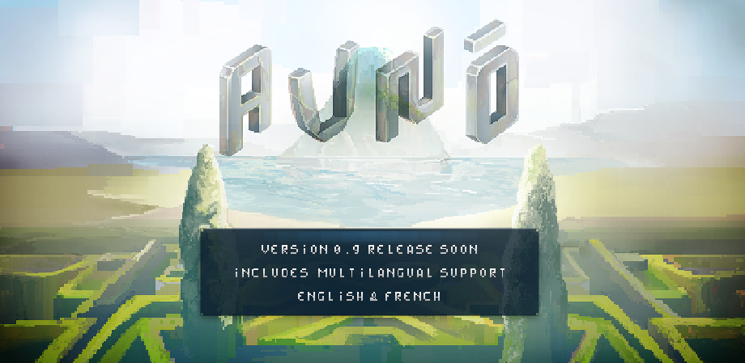

<!--  USE FOR TESTING -->
  
`AVNO` is a pixel art adventure game based inspired by `DANIEL DEFOE`'s Robinson Crusoe, first published in 1719.
The game is splitted into several chapter, depending on development timeline. 
You can play the first chapter on your browser.

Chapter #1, <i>Back to the Shore</i>, is online and features English and French languages.
Latest news and development updates will be published on this site.
