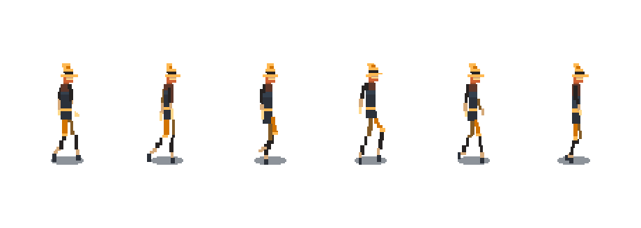

<!--  USE FOR TESTING -->
<!-- <!-- USE FOR PRODUCTION -->
The game is an `Artistic` and personal project made with my 10 year old son. We started to create this adventure game back when my son was playing [The Secret of Monkey Island].

As nostalgia grew from that period when I was myself a kid, I tried to create with some pixel art assets, coding the first lines, and eventually release the Chapter 1 of Avno. Since creating a game is long and fastidious process, I decided to split the development in chapters.
  
<!--[TRY IT]({{site.baseurl | prepend: site.url}}){:target="_blank"}-->  

  
Open your browser and access the server with this address:

http://localhost:8000


[The Secret of Monkey Island]: https://en.wikipedia.org/wiki/The_Secret_of_Monkey_Island
