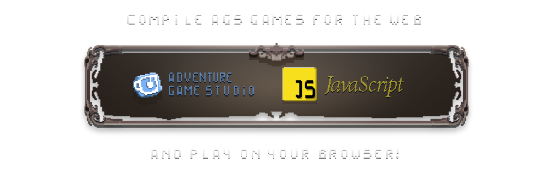

<!-- USE FOR PRODUCTION --><!--  -->
`AVNO` has been developped using Chris Jones [Adventure Game Studio] editor. `AGS` allows to create Sierra and LucasArts-style graphical adventure games. It is based on a `ROOM` system, each room being connected to an another and contains Walkable areas, Objects and interactions you choose to code. `AGS` is a simple way to create and compile your own adventure game.
  
<!--[>> ACCESS THE GAME (on a new tab)]({{site.baseurl | prepend: site.url}}){:target="_blank"}-->  

`AVNO` is free to play. As `AGS Studio` offers Javascript compilation, every AGS project can be released online or locally using Python webserver. For running your `AGS` game as a Javascript build locally, install [Python 3].

Here is an example of how to run an instance of the game locally using [Python 3] HTTP webserver:
<ul>
<li>First, copy the assets to a chosen directory (i.e. MYPATH\MYGAME).</li>
<li>Install Python.</li>
<li>Run Windows Powershell or Cmd, or Terminal on Linux/BSD systems.</li>
</ul>
Then, enter the following:

cmd
 python3 -m http.server
#=> Or in Python 2.x
 python -m http.server


[Adventure Game Studio]: https://www.adventuregamestudio.co.uk/
[Python 3]: https://www.python.org/downloads/
