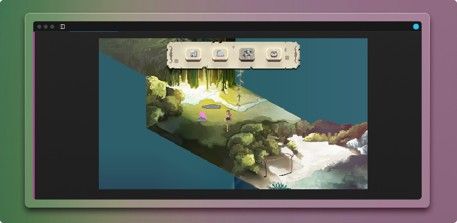

<!-- USE FOR PRODUCTION --><!--  -->
  The initial game is viewed from the side, with a bit of parallax for background graphics. Then, it switched to `isometric view` and the result looked more convincing.

Despite [Monkey Island]'s influence, Avno doesn't adopt traditional point and click or graphical adventures look. The development progress, with trials and errors, made it quite different from the LucasArts games used as references.

[Monkey Island]: https://en.wikipedia.org/wiki/The_Secret_of_Monkey_Island
